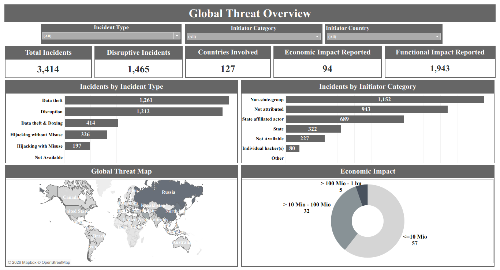
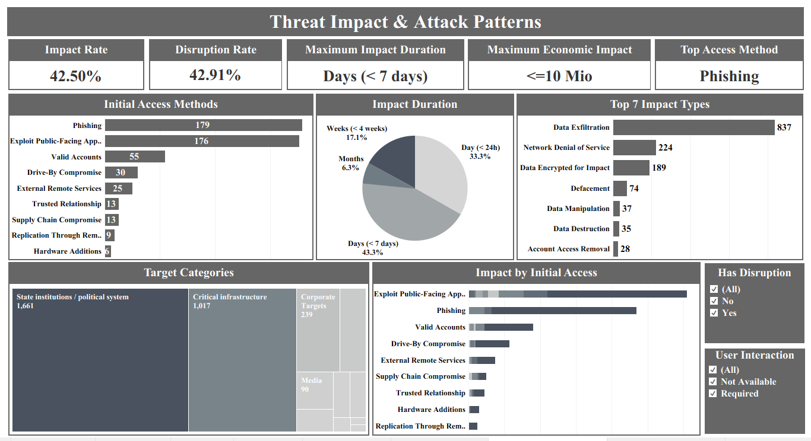
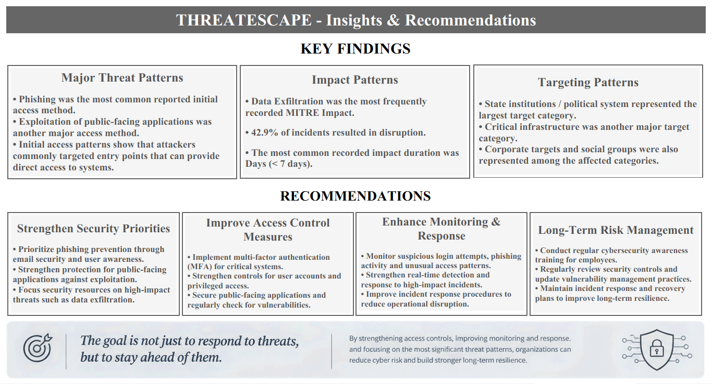

# 🛡️ThreatEscape — Global Cyber Threat Intelligence Dashboard


---

## Project Overview

**ThreatEscape** is an interactive **Tableau cybersecurity analytics dashboard** developed to analyze global cyber threat incidents and identify meaningful patterns across attack methods, incident impact, disruption, economic impact, and incident duration.

The dashboard transforms cybersecurity data into interactive visual insights, helping users understand attack patterns, identify high-impact incidents, and translate analytical findings into practical cybersecurity recommendations.

The project incorporates **MITRE ATT&CK concepts**, particularly **Initial Access** and **Impact**, to provide a structured view of cyber threat activity.

---

## Objective

- Analyze global cybersecurity incidents
- Identify major attack patterns and characteristics
- Analyze **MITRE Initial Access** methods
- Examine **MITRE Impact** techniques
- Understand economic impact associated with incidents
- Analyze incident duration and disruption
- Identify high-impact cybersecurity events
- Generate actionable cybersecurity recommendations
- Support data-driven security decision making

---

## 🛠️ Tools & Technologies

- Tableau
- Microsoft Excel
- Data Cleaning & Transformation
- Data Analysis
- Data Visualization
- Tableau Calculated Fields
- Interactive Dashboards
- MITRE ATT&CK Framework
- Business Intelligence

---

## 📈 Dashboard Features

- 🌐 Global Cyber Threat Overview
- 📊 Total Incidents Analysis
- 🌍 Country-level Incident Analysis
- 💰 Economic Impact Analysis
- ⏱️ Incident Duration Analysis
- 🔐 MITRE Initial Access Analysis
- ⚠️ MITRE Impact Analysis
- 🚨 Threat & Impact Pattern Analysis
- 🔄 Disruption Analysis
- 🎛️ Interactive Filters
- 💡 Key Findings
- 🎯 Cybersecurity Recommendations

---

## 📷 Dashboard Preview

### Global Threat Overview



### Threat Impact & Attack Patterns



### Insights & Recommendations



---

## 💡 Key Insights

- Analyzed **1,465 cybersecurity incidents** across **127 countries**.
- Identified **94 economic impact records/categories** within the analyzed dataset.
- **396 incidents** fall within the under-7-day duration analysis after applying the relevant filters.
- Examined different **MITRE Initial Access** methods used across cybersecurity incidents.
- Analyzed the relationship between **Initial Access** and **MITRE Impact**.
- Evaluated economic impact to identify potentially high-impact incidents.
- Analyzed disruption as an additional indicator of cybersecurity incident severity.
- Identified opportunities for stronger preventive controls and faster incident response.

---

## 🔍 Analytical Approach

The project follows a structured data analytics workflow:

```text
Raw Cybersecurity Data
        ↓
Data Cleaning & Preparation
        ↓
Exploratory Analysis
        ↓
Calculated Fields
        ↓
Tableau Visualizations
        ↓
Interactive Dashboards
        ↓
Key Findings
        ↓
Cybersecurity Recommendations
```
---
## 📂 Repository Structure

```text
ThreatEscape-Tableau-Cybersecurity-Dashboard
│
├── ThreatEscape.twbx
├── README.md
│
├── Dashboard
│   ├── eurepoc_global_dataset_1_3.xlsx
│   └── THREATSCAPE_Tableau_Cleaned.xlsx
│
├── Dashboard
│   ├── Global_Threat_Overview.png
│   ├── Threat_Impact_And_Attack_Patterns.png
│   └── ThreatEscape_Insights_Recommendations.png
│
└── Goal.png
```

---

## ▶️ How to Use

1. Clone or download the repository.
2. Open **ThreatEscape.twbx** in Tableau Desktop.
3. Explore the available dashboard pages.
4. Use the available filters to interact with the dashboards and analyze different cybersecurity patterns.
5. Hover over visualizations to view detailed insights and tooltips.
6. Review the key findings and recommendations presented in the final dashboard.

---

## 📈 Future Improvements

- Real-time Cybersecurity Data Integration
- Advanced Threat Prediction
- Machine Learning-based Threat Classification
- Automated Threat Severity Scoring
- Time-series Threat Forecasting
- Additional MITRE ATT&CK Technique Analysis
- Tableau Cloud / Tableau Server Deployment
- Automated Cybersecurity Monitoring

---

## 👩‍💻 About Me

**Srushti Khare**

🎓 **B.Sc. Computer Science Graduate (CGPA: 9.2)**

📚 Currently pursuing **Data Science & Data Analytics with AI** at **IT Vedant**.

💡 Passionate about transforming data into meaningful insights through **Excel, SQL, Python, Power BI, and Tableau**.

### Connect with Me

- 💼 **LinkedIn:** [https://www.linkedin.com/in/srushtikhare/](https://www.linkedin.com/in/srushtikhare/)
- 💻 **GitHub:** https://github.com/SrushtiKhare

---

## ⭐ If you found this project helpful, consider giving it a star!
